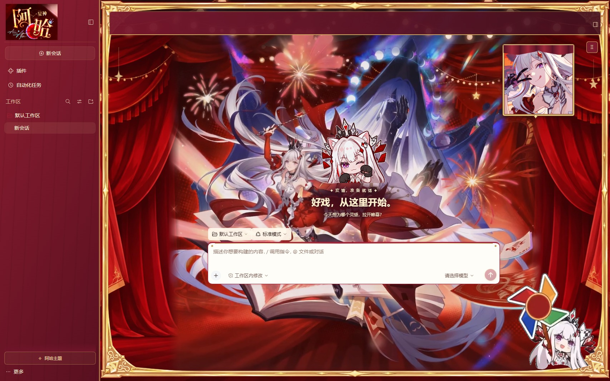
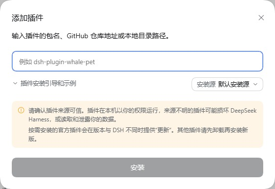
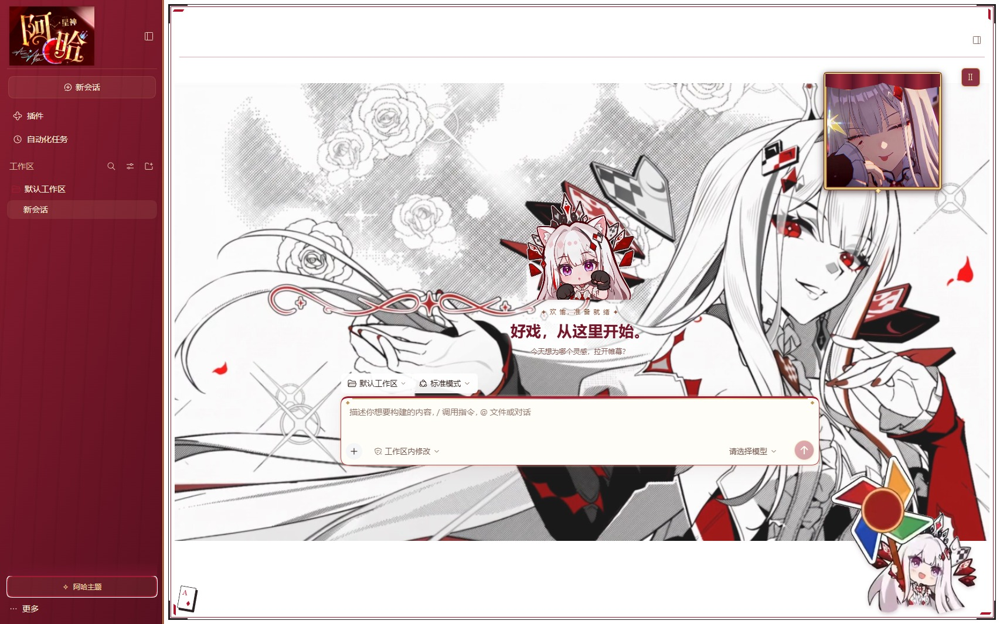
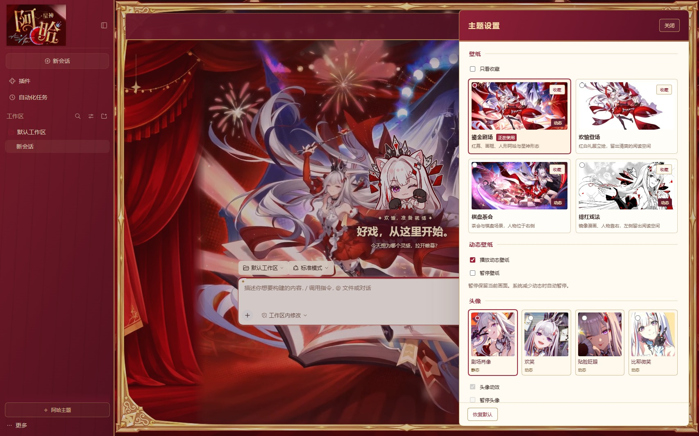

# AHA-DSH-wallpaper

适用于 DeepSeek Harness（DSH）的非官方阿哈红金剧场主题。用深红帷幕、鎏金边框和角色动效装饰工作区，聊天、文件、工具和任务继续用 DSH 原有的操作方式。默认静音，壁纸、欢迎贴纸、头像和风车的动效可以分别控制。

**当前版本 `v0.1.0-preview.19`** · [下载 .tgz 安装包](https://github.com/JonathanChang-alt/AHA-DSH-wallpaper/releases/download/v0.1.0-preview.19/dsh-aha-theme-0.1.0-preview.19.tgz) · [版本说明与校验文件](https://github.com/JonathanChang-alt/AHA-DSH-wallpaper/releases/tag/v0.1.0-preview.19)



*截图来自 Windows 上 DSH 官方 Web Host 的独立演示环境。上图为默认「鎏金剧场」，左栏底部是「阿哈主题」设置入口。*

## 下载与安装

准备已安装的 **DeepSeek Harness `0.2.1-rc.2`**。本预览在该版本随附的官方 Web Host 中验证。预构建包已包含主题需要的图片和视频，可以直接安装。

1. 在 [发布页](https://github.com/JonathanChang-alt/AHA-DSH-wallpaper/releases/tag/v0.1.0-preview.19) 的 **Assets** 中下载 `dsh-aha-theme-0.1.0-preview.19.tgz`，保留原文件。
2. 打开 DSH，点击左侧 **「插件」**，再点右上 **「添加插件」** 旁的下拉箭头，选择 **「安装第三方插件」**。
3. 在 **「包名或地址」** 输入框中粘贴 `.tgz` 的完整本机路径，例如 `C:\Downloads\dsh-aha-theme-0.1.0-preview.19.tgz`。直接使用路径，保持默认安装源，然后点 **「安装」**。
4. 安装完成后点 **「立即启用」**。如果已经关闭安装窗口，可在 **「插件 → 已安装插件」** 中找到 `dsh-aha-theme` 并打开它的开关。
5. 返回会话页，看到红色侧栏和底部 **「阿哈主题」** 即可开始使用。点击该入口打开设置，也可以点击右上角头像。



如果使用远程 Web Host，第 3 步填写运行 Host 的机器上实际存在的文件路径。想核对下载是否完整，可在 PowerShell 使用 `Get-FileHash -Algorithm SHA256`，把结果与 [发布页的 `SHA256SUMS.txt`](https://github.com/JonathanChang-alt/AHA-DSH-wallpaper/releases/download/v0.1.0-preview.19/SHA256SUMS.txt) 对照。

### 停用、升级与回滚

| 目的 | 操作 |
| --- | --- |
| 暂时停用 | 在「插件 → 已安装插件」关闭 `dsh-aha-theme` 的开关。之后可再次启用。 |
| 升级或回滚 | 保存目标版本的 `.tgz`，在插件详情中卸载当前版本，再按上面的步骤安装并启用目标版本。 |
| 卸载 | 打开 `dsh-aha-theme` 的插件详情，选择卸载并确认。 |
| 与其他皮肤切换 | 建议先关闭当前的完整皮肤，再启用目标皮肤。想保留原有桌面配置，可以用下文的独立试用流程。 |

## 功能与使用方法

### 壁纸、收藏与阅读

打开 **「阿哈主题 → 壁纸」**，点击卡片切换。点卡片上的「收藏」可加入或移出收藏，勾选「只看收藏」筛选图库。

| 壁纸 | 播放方式 | 画面特点 |
| --- | --- | --- |
| **鎏金剧场** | 动态，默认壁纸 | 完整金框与清晰的深红帷幕。会话空间足够时，点缀吊星和微光。 |
| **欢愉登场** | 静态 | 红白礼服人物立绘，留出浅色阅读空间。 |
| **棋盘茶会** | 动态 | 棋盘、棋子和茶会场景，人物位于右侧。 |
| **绯红戏法** | 动态 | 红黑白漫画镜像呈现，人物位于右侧。聊天正文和输入框靠左，右下留给小阿哈。 |

- **暂停壁纸**。点击壁纸右上角的暂停按钮，或在主题设置勾选「暂停壁纸」，定格在当前画面。取消暂停后继续播放。关闭「播放动态壁纸」切回静态图。
- **显影和阅读遮罩**。「显影」调节壁纸可见程度，「阅读遮罩」调节聊天底色的遮挡程度。长对话、代码或表格较多时，可以调高遮罩来提高文字对比度。
- **环境动效**。单独控制「鎏金剧场」的吊星和微光。暂停该壁纸时，环境动效也会暂停。



### 欢迎贴纸、头像与风车

| 功能 | 效果与操作 |
| --- | --- |
| **三款欢迎贴纸** | 新会话随机显示「眨眼开场」「捧心好戏」或「害羞探头」，同一个会话会记住选中的款式。每次播完停留约 6 秒再重播。可在「装饰」里关闭「欢迎贴纸动效」，显示对应静态贴纸。 |
| **四款右上角头像** | 200 × 200 逻辑像素的红金框。新安装默认显示静态「剧场肖像」，在「头像」区可选动态「欢笑」「贴脸眨眼」或「比耶微笑」。动态款支持「暂停头像」定格，也可关闭「头像动效」使用静态图。 |
| **风车小阿哈** | 位于右下边框内侧。空闲时静止，模型回复或执行任务时转动。点击小阿哈可暂停或恢复，也可在「装饰」里关闭「风车」。 |
| **输入与任务动效** | 为原生输入区和正在运行的任务加入聚光、星芒、面具或扑克牌装饰，使用「输入与任务动效」开关控制。 |
| **完成印章** | 当前会话中的新任务成功完成时，短暂显示「圆满谢幕」印章。可关闭「完成印章」。 |



主题偏好保存在当前浏览器环境中，刷新后会保留。点击设置底部「恢复默认」可重置主题偏好。页面进入后台或系统启用「减少动态效果」时，主题媒体会暂停。窗口变窄或打开文件预览后，头像、风车等装饰会按空间收起，优先留出阅读和输入区域。

## 常见问题

- **装好了，界面还是原样？** 确认 `dsh-aha-theme` 已启用，随后返回会话页。当前包通过官方 Web Host 验证，桌面 Electron 原生窗口的最终装载仍待实测。
- **壁纸或头像没有动？** 确认选中卡片有「动态」标记，再检查动效开关、手动暂停状态和系统的「减少动态效果」。动态资源加载失败时会回退为静态图。
- **小阿哈没有转动或暂时消失？** 风车只在当前会话回复或执行任务期间转动。检查「风车」「暂停风车」开关，或尝试增大窗口、收起右侧文件面板。
- **想清空当前外观偏好？** 点击「阿哈主题」底部的「恢复默认」。想暂时恢复 DSH 基础外观，在插件列表关闭主题即可。

## 兼容性与验证

| 项目 | 已验证范围 |
| --- | --- |
| DSH | `0.2.1-rc.2` |
| Windows | 安装随附的官方 Web Host，使用独立 profile 实际安装、启用和切换。 |
| Windows 原生 Electron 窗口、macOS | 最终装载和界面实机验证待完成。 |
| 布局尺寸 | 2560 × 1600、1706 × 1066、1280 × 800、1024 × 768 逻辑视口。 |

40 项 Node 测试已通过，安装包已验证默认静态头像、三款动态头像切换、镜像壁纸、风车和停用后的媒体释放。验证细节见 [VALIDATION.md](VALIDATION.md)。当前提供红白浅色外观，音乐和紫白模式在后续计划中。

## 从源码构建与独立试用

需要 Node.js **22.15 或以上版本**。在克隆或下载的源码目录依次运行以下命令。

```powershell
npm ci --ignore-scripts
npm test
npm run build
npm pack --ignore-scripts
```

构建完成后，可在已安装 DSH 的 Windows 环境启动独立试用。

```powershell
npm run trial
npm run trial:open
```

它使用源码目录内的 `.trial-home` 和独立 `aha-trial` profile，默认只监听 `127.0.0.1:19659`。启动后可先关闭原生登录提示评审外观。要使用模型功能，可在独立环境中登录。执行 `npm run trial:stop` 停止试用。重新构建后，停止再启动即可加载新版本。

DSH 安装目录不同时，可在项目根目录指定目录和端口。

```powershell
powershell -NoProfile -ExecutionPolicy Bypass -File scripts/start-trial.ps1 -DshInstallDir 'D:\Apps\DeepSeek Harness' -Port 19660
npm run trial:open
```

主题界面和播放逻辑位于 `src/`，内置资源和素材记录位于 `assets/`，构建和试用脚本位于 `scripts/`。详见 [扩展接口](design/INTERFACES.md) 和 [动态播放约定](design/DYNAMIC_PLAYBACK_SPEC.md)。[自动构建模板](design/ci-template.yml) 可供维护者使用。

## 许可与素材

原创代码和文档采用 [MIT](LICENSE)。插画、角色形象、字标、视频及衍生视觉素材的权利归各自权利方，其来源和分发状态见 [NOTICE](NOTICE) 和 [素材记录](assets/provenance.json)。本项目是非官方同人主题。
